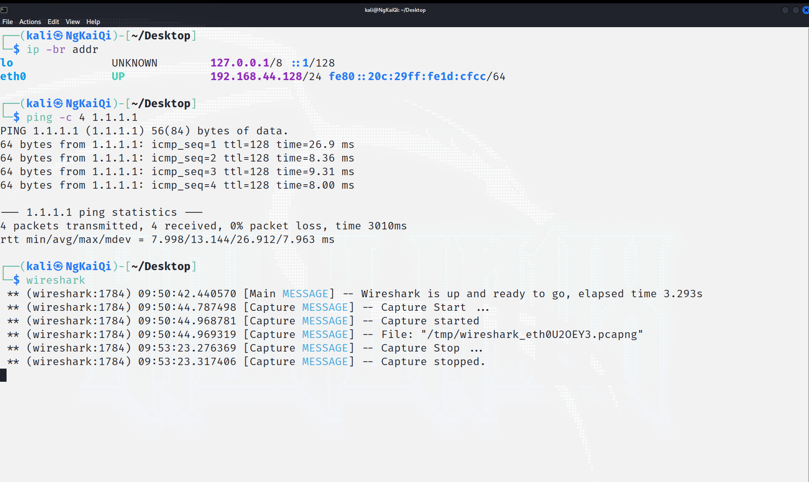
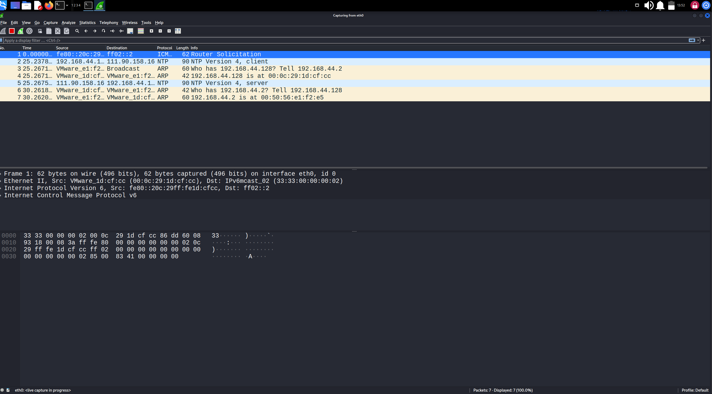
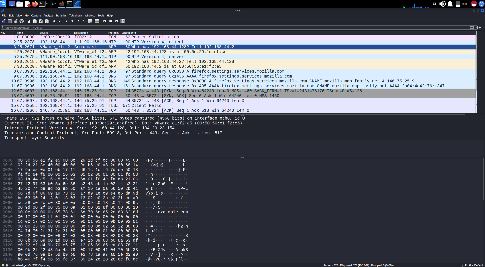
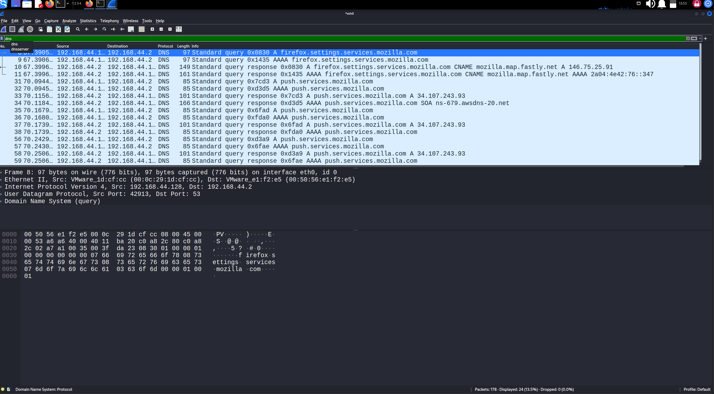
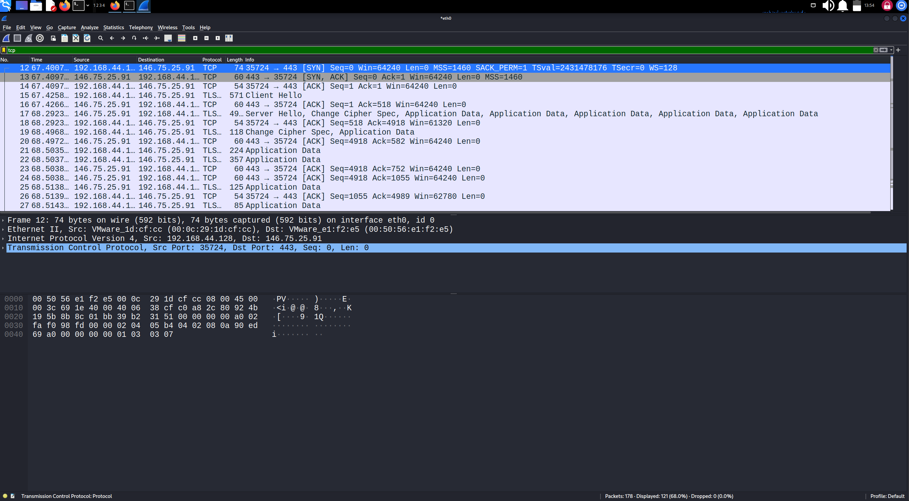
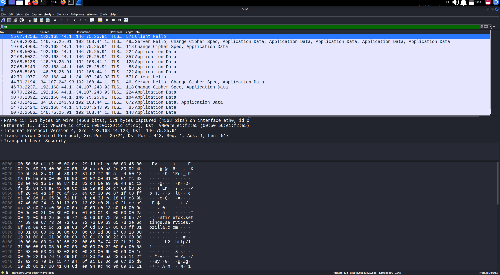
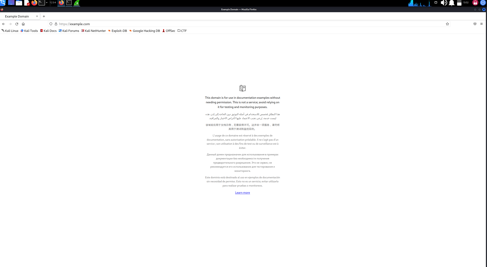
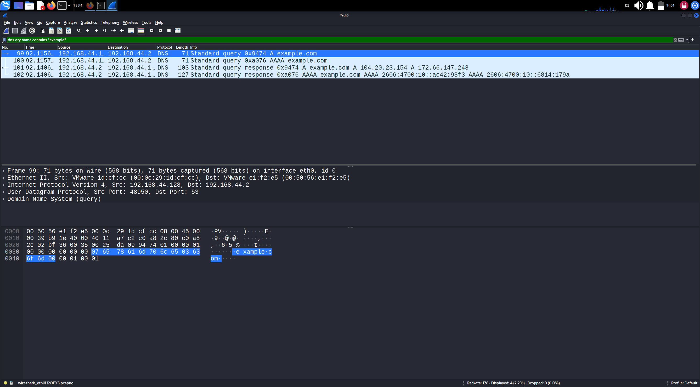
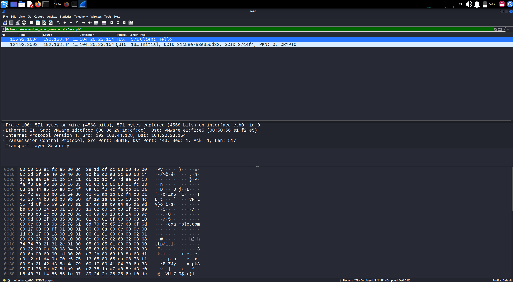
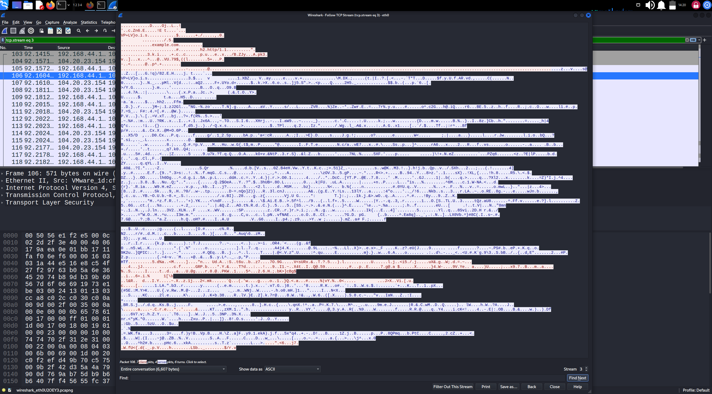

# Network Traffic Analysis Report

## 1. Objective

Use Wireshark to capture traffic from my own lab VM and identify DNS, TCP and TLS behaviour when a browser connects to a website over HTTPS.

## 2. Environment

- Kali Linux 2022.1 VM in VMware Workstation, NAT networking
- VM interface `eth0`, address `192.168.44.128/24`
- NAT gateway and DNS server `192.168.44.2`
- Connectivity test: `ping -c 4 1.1.1.1` returned 4 of 4 replies, 0% packet loss, average round trip about 12.6 ms

## 3. Method

1. Started Wireshark on `eth0`.
2. Left Firefox running and browsed to `https://example.com`.
3. Stopped the capture and applied display filters one at a time.
4. Inspected packet details and the hex view for selected packets.

Note: my first attempt used a mistyped address (`https://example/com`) and returned "Server Not Found". I corrected the URL and repeated the capture.

## 4. Capture 1: Firefox background traffic

The first capture contained 839 packets.

### 4.1 Start of capture

The first packets were not browsing traffic:

- **NTP** (UDP port 123): the VM asked an external time server for the time and received a reply.
- **ARP**: the VM and the gateway (`192.168.44.2`) resolved each other's MAC addresses.

### 4.2 Overall sequence

With no filter applied, the order of events for one connection is visible: DNS query and response, then the TCP handshake, then the TLS Client Hello.

### 4.3 DNS (`dns` filter)

42 of 839 packets matched.

- Queries went from `192.168.44.128` to `192.168.44.2` on UDP port 53.
- Each name was requested twice: an **A** record (IPv4) and an **AAAA** record (IPv6).
- `firefox.settings.services.mozilla.com` returned a CNAME to `mozilla.map.fastly.net` and the address `146.75.25.91`.
- `push.services.mozilla.com` resolved to `34.107.243.93`.
- `safebrowsing.googleapis.com` resolved to `173.194.41.95`.

These are Firefox's own background connections, not pages I opened.

### 4.4 TCP (`tcp` filter)

766 of 839 packets matched.

Frames 11 to 13 show the three-way handshake from `192.168.44.128:49896` to `146.75.25.91:443`:

1. `SYN`, client asks to connect
2. `SYN, ACK`, server accepts
3. `ACK`, client confirms

The destination port 443 is the standard HTTPS port.

### 4.5 TLS (`tls` filter)

334 of 839 packets matched.

- Frame 14 is a **Client Hello** (571 bytes) from the VM.
- The server replied with a **Server Hello** and **Change Cipher Spec**.
- Everything after that is labelled **Application Data**, which is encrypted, so the content cannot be read.
- In the hex view of the Client Hello, the server name `firefox.settings.services.mozilla.com` is readable, along with the offered application protocols `h2` and `http/1.1`.

## 5. Capture 2: visiting example.com

> TODO: fill in from your own screenshots before publishing. Delete any line you did not actually observe.

- Page loaded successfully at `https://example.com`.

- **DNS:** query for `example.com` answered with address(es): `[TODO]`

- **TLS Client Hello** for `example.com` found with filter `tls.handshake.extensions_server_name contains "example"`. TLS version shown in the Server Hello: `[TODO]`

- **TCP stream:** handshake, TLS exchange and encrypted data for this single connection.

## 6. What I Learned

- DNS queries are sent in plain text, so anyone who can see the traffic can see which names a device looks up.
- HTTPS encrypts the content, but the server name in the TLS Client Hello and the destination IP addresses are still visible.
- Even with no browsing, a machine generates background traffic (NTP, ARP, browser update and safe-browsing connections).
- Display filters make a large capture manageable: 839 packets reduced to 42 DNS packets in one step.

## 7. Limitations

- The capture is short and covers only one VM.
- In NAT mode I can see only my own VM's traffic, not other devices on the network.
- I did not decrypt TLS, so I cannot comment on the content of the encrypted data.

## 8. Privacy Notes

- Only my own VM in my own lab was captured.
- The raw `.pcapng` file is kept private.
- Screenshots were cropped to remove personal information.
